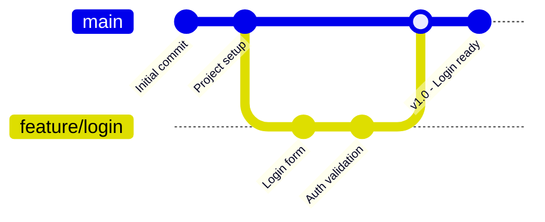
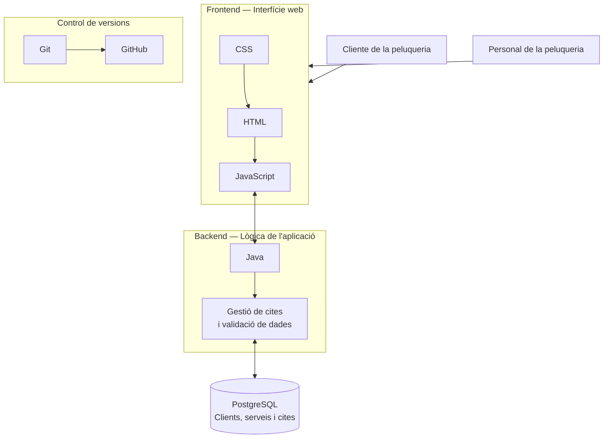
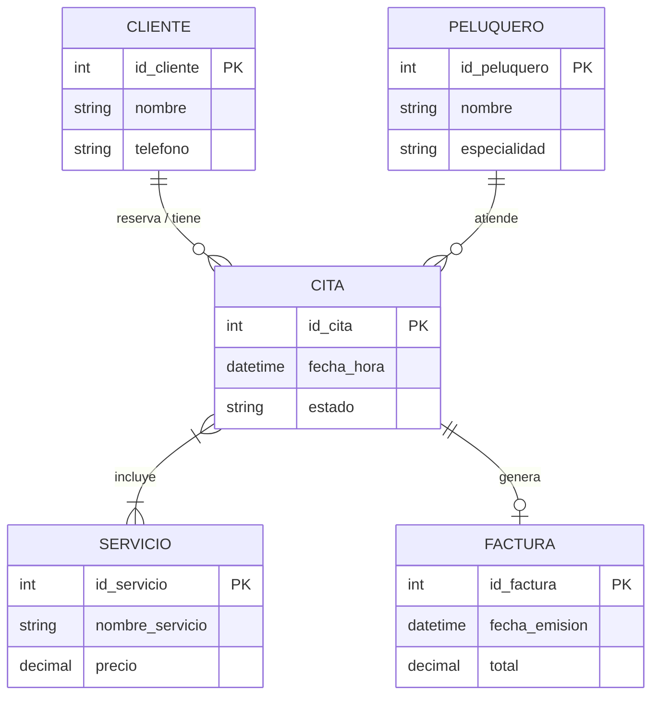
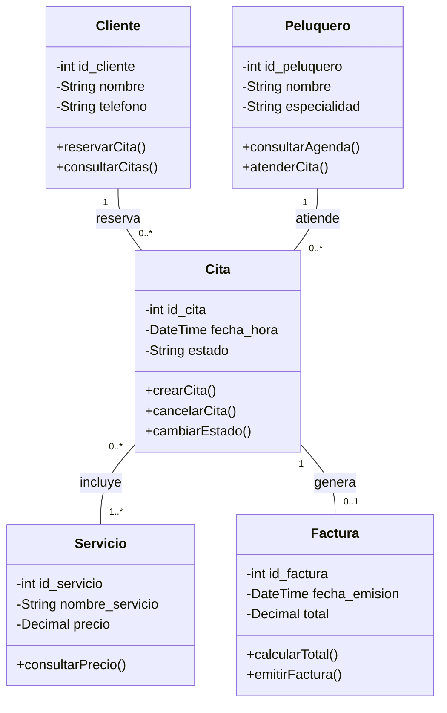
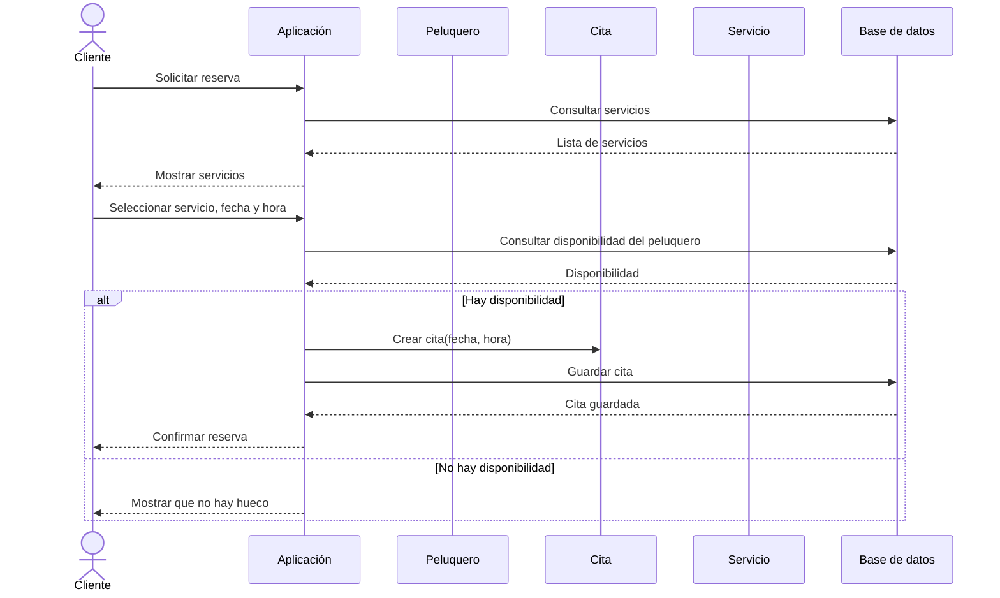
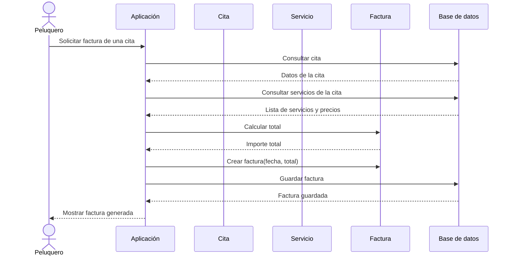

# Projecte Intermodular - Projecte Peluquería

**Autor/s:** Marc Bonet, Isabel Martínez
**Data:** 7/10/26
**Grup:** 1

---

# 1. Introducció
- Explicar el cas d'ús
    - Qui és el **End User**?
        > El End User de la aplicación es el cliente de la peluquería, que utilizará la plataforma para consultar la disponibilidad, reservar citas y gestionar sus propias reservas. Además, el personal de la peluquería también utilizará la aplicación para organizar y gestionar las citas de los clientes. 

    - Quin problema soluciona?
        > La aplicación busca solucionar el problema de la **gestión y organización de las citas en una peluquería**. Actualmente, gestionar las reservas de forma manual puede provocar confusiones, citas duplicadas, olvidos o dificultades para consultar los horarios disponibles, con la aplicacion facilitaremos tanto a los clientes como al personal de la peluquería la consulta, reserva, modificación y cancelación de citas.

    - Com soluciona el problema?
        > La aplicación solucionará el problema de la organización de las citas mediante un sistema de reservas online. Los clientes podrán consultar los horarios disponibles y reservar, modificar o cancelar sus citas.   El personal de la peluquería dispondrá de un calendario centralizado donde podrá consultar todas las citas ordenadas por fecha y hora, evitando confusiones, solapamientos y errores en la gestión de las reservas.   De esta manera, la peluquería podrá gestionar las citas de forma más rápida, ordenada y eficiente, mientras que los clientes tendrán mayor facilidad para gestionar sus reservas.

# 2. Requeriments
- Requeriments **funcionals**
    - RF01: Como usuario quiero reistrarme o iniciar sesion para poder utilizar la aplicación y gestionar mis citas.
    - RF02: Como cliente quiero consultar los servicios disponibles para conocer sus precios y duración.
    - RF03: Como cliente quiero reservar una cita para poder acudir a la peluquería en una fecha y hora determinadas.
    - RF04: Como cliente quiero consultar mis próximas citas para saber cuándo tengo que acudir a la peluquería.
    - RF05: Como cliente quiero modificar o cancelar una cita para poder cambiar mis planes si es necesario.
    - RF06: Como administrador quiero crear, modificar y eliminar servicios para mantener actualizada la oferta de la peluquería.
    - RF07: Como administrador quiero consultar y gestionar las citas para organizar correctamente la agenda de la peluquería.
    - RF08: Como administrador quiero gestionar los horarios y la disponibilidad de los peluqueros para organizar las citas correctamente.
    - RF09: Como cliente quiero consultar mi historial de citas para conocer los servicios que he realizado anteriormente.
    - RF10: Como cliente quiero recibir un recordatorio de mi cita para no olvidarme de acudir a la peluquería.
- Requeriments **no funcionals**
    - RNF01: La aplicacion debe ser fácil e intuitiva de utilizar.
    - RNF02: La aplicación, debe adaptarse a móviles, tablets y ordenadores.
    - RNF03: Las páginas principales deben cargar en un tiempo inferior a 3 segundos en condiciones normales.
    - RNF04: Los datos de usuario deben almacenarse de forma segura.
    - RNF05: Solo los administradores podrán acceder a las funciones de gestión de la peluquería.
    - RNF06: La aplicación debe estar disponible durante el horario habitual de la peluquería.
- User Stories (format: *Com a [rol], vull [acció], per a [benefici]*)
- Estimació de **punts** de les User Stories (Planning Poker / Fibonacci)

    | ID   | Como...       | Quiero...                                                    | Para...                                                       | Puntos |
    | ---- | ------------- | ------------------------------------------------------------ | ------------------------------------------------------------- | -----: |
    | US01 | Usuario       | registrarme o iniciar sesión                                 | poder utilizar la aplicación y gestionar mis citas            |    5   |
    | US02 | Cliente       | consultar los servicios disponibles                          | conocer sus precios y duración                                |    3   |
    | US03 | Cliente       | reservar una cita                                            | poder acudir a la peluquería en una fecha y hora determinadas |    8   |
    | US04 | Cliente       | consultar mis próximas citas                                 | saber cuándo tengo que acudir a la peluquería                 |    3   |
    | US05 | Cliente       | modificar o cancelar una cita                                | poder cambiar mis planes si es necesario                      |    5   |
    | US06 | Administrador | crear, modificar y eliminar servicios                        | mantener actualizada la oferta de la peluquería               |    5   |
    | US07 | Administrador | consultar y gestionar las citas                              | organizar correctamente la agenda de la peluquería            |    8   |
    | US08 | Administrador | gestionar los horarios y la disponibilidad de los peluqueros | organizar las citas correctamente                             |    8   |
    | US09 | Cliente       | consultar mi historial de citas                              | conocer los servicios que he realizado anteriormente          |    3   |
    | US10 | Cliente       | recibir un recordatorio de mi cita                           | no olvidarme de acudir a la peluquería                        |    5   |

!!! TIP
    Pots organitzar les User Stories en una taula:

    | ID | Com a... | Vull... | Per a... | Punts |
    |----|----------|---------|----------|-------|
    | US01 | | | | |

# 3. Estructura Git
- Diagrama de l'estructura de branques (Gitflow, Trunk-based, etc.) amb **mermaid**

- Justificació de l'estructura triada

    > Hemos elegido una estructura basada en una rama principal main y ramas feature para desarrollar las diferentes funcionalidades de la aplicación.   La rama main contiene siempre la versión estable del proyecto. Para desarrollar una nueva funcionalidad, se crea una rama independiente a partir de main, por ejemplo feature/login. De esta forma, cada integrante puede trabajar en una funcionalidad sin modificar directamente la rama principal. Una vez terminada y comprobada la funcionalidad, se realiza un merge hacia main. Hemos elegido esta estructura porque somos un equipo pequeño de dos personas y consideramos que utilizar un sistema más complejo como Gitflow no sería necesario para este proyecto.

- Convenció de noms de branques i commits

    > Para las ramas utilizaremos nombres descriptivos que indiquen claramente la funcionalidad que se está desarrollando.  Las ramas de nuevas funcionalidades seguirán el formato: `feature/nombre-funcionalidad`

    > Para los commits utilizaremos una convención basada en Conventional Commits, utilizando diferentes tipos según el cambio realizado:
    >- `feat`: nueva funcionalidad.
    >- `fix`: corrección de errores.
    >- `docs`: cambios en la documentación.
    >- `style`: cambios de formato o estilos.
    >- `refactor`: modificación del código sin añadir funcionalidades.
    >- `test`: creación o modificación de pruebas.

!!! TIP BONUS POINTS
    **BONUS**:
    - Implementar git hooks (pre-commit, commit-msg) per a normalitzar missatges de commit.
    - Implementar `.gitignore` adequat al stack.
    - Ús de Conventional Commits.

# 4. Tecnologies
- Stack triat (Frontend, Backend, Base de Dades, Infraestructura)
- Justificació de la tria de cada tecnologia

    > Java para el desarrollo de la logica de la aplicación. Con este tendremos el lenguaje principal. Este es un lenguaje orientado a objetos que facilita la organización y el codigo entre clases, este lenguaje permite el desarollo de aplicaciones estructuradas, tambien tiene facilidad de gestionar errores y validar datos, y de cara al futuro permite plantear diferentes integraciones.

    > PostgreSQL sera el sgbd encargado de conservar la información de los diferentes cliente, este es un sistema de codigo abierto que nos permite definir relaciones, generar restricciones de identidad y transacciones que garantizan la coherencia de datos.

    > HTML i CSS se utilitzaran para construir la interfície de la aplicacion i organitzar visualmente la información que necessiten consultar los responsables. HTML permite estructurar el contenido mediante elementos semanticos. En cuanto a CSS, este permite definir el disseño visual, los colores, la tipografia, los espacios i la distribución de los componentes. A este diseño de la interficie le complementará JavaScript el cual proporcionará comportamientos interactivos.

    > Git y GitHub serán las herramientas utilizadas para mantener el control de versiones, la colaboración entre diferentes miembros del grupo y donde se pondrá gestionar el historial de cambios de los codigos.

- Diagrama d'arquitectura (mermaid)

# 5. Solució
- Quines pantalles s'han implementat (captures de pantalla)
- Taules de la base de dades implementades
-### Diseño inicial de la base de datos de SalonFlow

La base de datos de SalonFlow estará diseñada para gestionar las citas de una peluquería. Inicialmente, se propone utilizar **4 tablas: cliente, servicio, cita y factura**.

- **Cliente:** almacenará los datos personales y de contacto de los clientes.
- **Servicio:** guardará los servicios que ofrece la peluquería, sus precios y su duración.
- **Cita:** registrará las citas, relacionando a cada cliente con el servicio solicitado, la fecha y la hora.
- **Factura:** almacenará el importe de las citas facturadas.

Para esta primera fase se diseñará la tabla `cliente`, que permitirá registrar y consultar la información de los clientes. El resto de las tablas se definirán posteriormente.
- Lògiques de negoci principals implementades
- Funcionalitats pendents / fora d'abast (si n'hi ha)

# 6. Diagrames
- Diagrama de Dades (ER)

- Diagrama de Classes (si aplica)

- Diagrama de Seqüència d'almenys 1 procés

**Proceso realizar reserva de cita**

**Proceso de generacion de una factura**

# 9. Conclusions
- Dificultats trobades
- Aprenentatges
- Possibles millores futures

# Annexes

## Annexe I: SCRUM
En aquest annexe s'inclourà tota la documentació relativa a la gestió del projecte, així com una imatge del Burndown chart

---
# EN EL SEGÓN TRIMESTRE
# 7. Testing
- Estratègia de proves (unitàries, integració, E2E)
- Cobertura de codi aconseguida
- Eines utilitzades (Jest, PHPUnit, Cypress, etc.)

# 8. Desplegament
- Entorn de desplegament (Docker, servidor, cloud...)
- Variables d'entorn necessàries

---

# EN EL SEGÓN TRIMESTRE
# Annexes
## Annexe II: Manual d'Usuari
Guia d'ús de l'aplicació per a l'usuari final.

## Annexe III: Manual Tècnic
Documentació tècnica addicional (API, endpoints, etc.)